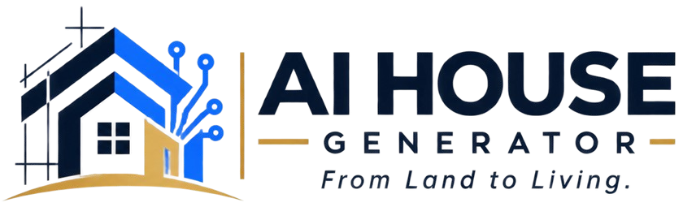
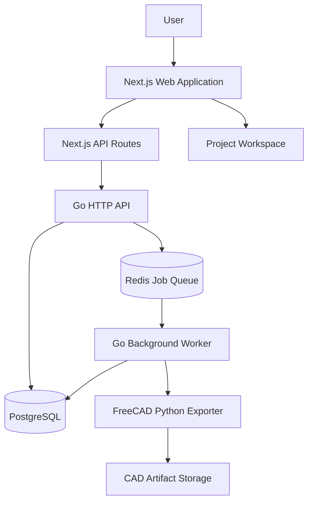
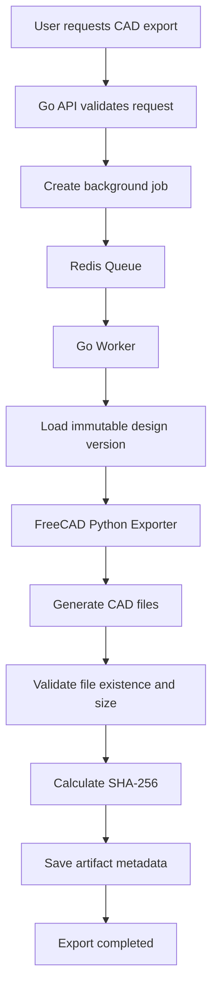

# AI House Generator

<p align="center">
  
</p>

<p align="center">
  <strong>AI-Assisted Residential Design, Intelligent Project Management & CAD Automation</strong>
</p>

<p align="center">
  <em>From House Design Concepts to Structured CAD Deliverables.</em>
</p>

**AI House Generator (AHG)** is a software platform under development by **PT DIGI MEDIA KOMUNIKA**, designed to connect residential design workflows, structured floor-plan management, and automated CAD document generation.

The platform aims to streamline the journey from initial house-design requirements to structured digital plans and CAD deliverables, while establishing a foundation for future AI-assisted design, visualization, material estimation, and construction ecosystem integration.

The current technical foundation combines a Next.js web application, Go backend services, PostgreSQL, Redis-based background processing, and FreeCAD Python automation.

---

## Table of Contents

- [Vision](#vision)
- [Business Overview](#business-overview)
- [Current Development Status](#current-development-status)
- [Implemented Features](#implemented-features)
- [Architecture](#architecture)
- [Technology Stack](#technology-stack)
- [Repository Structure](#repository-structure)
- [Requirements](#requirements)
- [Local Development Setup](#local-development-setup)
- [Application API](#application-api)
- [CAD Export Pipeline](#cad-export-pipeline)
- [Database and Security](#database-and-security)
- [Development and Testing](#development-and-testing)
- [Product Roadmap](#product-roadmap)
- [Business Model Opportunities](#business-model-opportunities)
- [Strategic Partnerships](#strategic-partnerships)
- [Commercial Opportunities](#commercial-opportunities)
- [Contact and Company Information](#contact-and-company-information)
- [License and Intellectual Property](#license-and-intellectual-property)

---

## Vision

Our vision is to develop an integrated digital platform that makes residential design workflows more accessible, structured, and connected.

AI House Generator is being developed around several long-term objectives:

- Simplify early-stage residential design workflows.
- Connect project requirements with structured floor-plan data.
- Automate the generation of selected 2D and 3D CAD deliverables.
- Preserve design history and support traceable revisions.
- Introduce AI-assisted design and intelligent automation.
- Connect architects, engineers, contractors, property developers, and material suppliers through digital workflows.
- Establish a foundation for a broader digital construction ecosystem.

The long-term direction is to evolve beyond a standalone house-design application into an integrated residential design and project technology platform.

---

## Business Overview

AI House Generator is a product initiative of **PT DIGI MEDIA KOMUNIKA**.

The company is developing AHG as a technology product with potential applications across residential design, architecture, engineering, construction, and property development.

### The problem we aim to address

Residential design projects can involve fragmented workflows across:

- Initial customer requirements and design briefs.
- Floor-plan creation and revisions.
- Communication between homeowners and design professionals.
- CAD document preparation.
- Design version management.
- Technical coordination between design and construction teams.
- Material and construction information.

AHG aims to establish a more connected workflow by keeping project information, floor-plan data, and generated CAD deliverables within a structured digital environment.

### Target markets

| Market segment | Potential value |
|---|---|
| Homeowners | Organize house requirements and participate in design development |
| Architects and design studios | Support early-stage layout development and revision management |
| Engineering consultants | Work with structured design data and CAD deliverables |
| Contractors | Improve design-information handoff and project coordination |
| Property developers | Explore repeatable residential design workflows |
| Building-material suppliers | Integrate product catalogs and material information |
| Educational institutions | Support digital architecture and engineering learning |
| Technology companies | Integrate CAD, BIM, AI, and construction-related services |

These are intended market segments. Their inclusion does not imply existing customers, commercial deployments, or signed agreements.

---

## Current Development Status

The project has an implemented foundation for project management, structured floor-plan workflows, immutable design versions, and asynchronous CAD exports.

| Capability | Current status |
|---|---|
| Web application foundation | Implemented |
| Project management workflow | Implemented foundation |
| Project detail and editing | Implemented |
| Structured floor-plan workflow | Implemented foundation |
| Room, wall, door, and window data | Implemented |
| Design version persistence | Implemented |
| Background CAD job processing | Implemented foundation |
| 2D DXF export | Implemented |
| 2D FCStd export | Implemented |
| 3D FCStd export | Implemented |
| 3D STEP export | Implemented foundation |
| AI-assisted design generation | Planned |
| Advanced 3D visualization | Planned / expanding |
| IFC/BIM interoperability | Planned |
| BOQ and material estimation | Planned |

**Important:** The current CAD exporter is an initial implementation. It does not yet generate a complete construction-ready architectural model. AI-assisted generation and other roadmap capabilities must not be interpreted as production features until implemented and validated.

---

## Implemented Features

### 1. Project Management

The web application provides a foundation for managing residential design projects.

Implemented workflows include:

- Project workspace.
- Project detail view.
- Project editing routes.
- Project-scoped API communication.
- Structured project data management.

### 2. Structured Floor-Plan Management

The platform supports structured floor-plan data representing:

- Rooms.
- Walls.
- Doors.
- Windows.

The floor-plan workflow includes:

- Element identifiers.
- Geometric data.
- Metric dimensions.
- Wall and opening references.
- Relevant site-boundary constraints.
- Input validation.
- Design version creation.

Saved floor-plan changes are persisted as identifiable design versions.

### 3. Immutable Design Versions

The system establishes a versioned design-data workflow.

Each saved design version can be used as a reference for downstream CAD generation.

This provides a foundation for:

- Design revision tracking.
- Traceable export inputs.
- Reproducible CAD generation.
- Project history management.

### 4. Asynchronous CAD Generation

CAD generation is handled through a dedicated background worker rather than being performed directly inside an HTTP request.

The current pipeline includes:

- CAD export job submission.
- Redis-backed job processing.
- Go worker execution.
- FreeCAD Python automation.
- Artifact metadata persistence.
- SHA-256 checksum generation.

### 5. CAD Deliverables

The current exporter supports the following outputs:

| Dimension | Format | Status |
|---|---|---|
| 2D | DXF | Implemented |
| 2D | FCStd | Implemented |
| 3D | FCStd | Implemented |
| 3D | STEP | Implemented foundation |
| 3D | STL | Not currently generated |
| BIM | IFC | Not implemented |

The database schema recognizes STL as an allowed artifact format, but the current exporter does not generate STL files.

---

## Architecture

AI House Generator uses a modular application architecture with separate web, API, database, background-processing, and CAD-generation responsibilities.



### Architecture principles

- Separate frontend and backend responsibilities.
- Keep project data in a structured database.
- Use immutable design versions as export references.
- Run CAD generation asynchronously.
- Persist artifact metadata and checksums.
- Keep generated files separate from application source code.
- Support future service integrations through modular architecture.

### CAD export workflow



---

## Technology Stack

| Layer | Technology |
|---|---|
| Frontend | Next.js |
| UI framework | React |
| Frontend language | TypeScript |
| Package manager | pnpm |
| Backend | Go |
| Database | PostgreSQL |
| Background queue | Redis |
| CAD automation | FreeCAD Python API |
| 2D CAD | DXF |
| 3D CAD | FCStd, STEP |
| Mobile workspace | Flutter project scaffold |
| Container environment | Docker-compatible runtime |

---

## Repository Structure

```text
ai-house-generator/
│
├── apps/
│   ├── web/
│   │   ├── public/
│   │   │   └── branding/
│   │   └── src/
│   │       └── app/
│   │
│   └── mobile/
│
├── services/
│   ├── api/
│   │   ├── cmd/
│   │   │   ├── server/
│   │   │   └── worker/
│   │   ├── internal/
│   │   │   ├── cad/
│   │   │   ├── database/
│   │   │   ├── projects/
│   │   │   ├── queue/
│   │   │   └── worker/
│   │   └── migrations/
│   │
│   └── ai/
│
├── docs/
├── add_azwar_roof.FCMacro
├── add_azwar_stairs_balcony.FCMacro
├── README.md
└── .env.example
```

The standalone roof, stairs, and balcony macros are separate from the current embedded worker exporter. Their presence does not mean these components are already included in the automated CAD export workflow.

---

## Requirements

| Dependency | Requirement |
|---|---|
| Node.js | `>=22.13.0` |
| pnpm | `12.22.0` |
| Go | `1.25.0` |
| PostgreSQL | 17 |
| Redis | Required for background jobs |
| FreeCAD | Required for CAD export |
| Flutter SDK | Required only for mobile development |
| Docker | Recommended for local infrastructure |

The exact FreeCAD Python executable path depends on the local installation.

---

## Local Development Setup

The following instructions assume Windows PowerShell.

### 1. Clone the repository

```powershell
git clone https://github.com/sazwarriyadhs/aihouse.git
cd aihouse
```

For development on the current CAD pipeline:

```powershell
git checkout feature/cad-export-pipeline
```

### 2. Configure environment variables

Create a local `.env` file based on `.env.example`.

Configure the required database, Redis, and CAD settings.

| Variable | Purpose |
|---|---|
| `POSTGRES_DB` | Database name |
| `POSTGRES_HOST` | PostgreSQL host |
| `POSTGRES_PORT` | PostgreSQL port |
| `POSTGRES_USER` | Database bootstrap account |
| `POSTGRES_PASSWORD` | Bootstrap account password |
| `POSTGRES_MIGRATOR_USER` | Migration account |
| `POSTGRES_MIGRATOR_PASSWORD` | Migration password |
| `POSTGRES_RUNTIME_USER` | Restricted runtime account |
| `POSTGRES_RUNTIME_PASSWORD` | Runtime password |
| `CAD_STORAGE_ROOT` | CAD artifact storage directory |
| `FREECAD_PYTHON` | FreeCAD-compatible Python executable |

The example FreeCAD path in `.env.example` is Windows-specific. Update it according to your installation.

Never commit real credentials, tokens, private keys, database dumps, or local environment files.

### 3. Install dependencies

```powershell
pnpm install
```

### 4. Start the web application

```powershell
pnpm --filter ./apps/web dev
```

Use the local URL printed by Next.js.

### 5. Start the Go API

Open a separate PowerShell terminal:

```powershell
Push-Location .\services\api
go run ./cmd/server
```

The default local API base URL configured in the web route is:

```text
http://127.0.0.1:8097
```

Configure `API_BASE_URL` if your API runs on a different address.

### 6. Start the background worker

Open another PowerShell terminal:

```powershell
Push-Location .\services\api
go run ./cmd/worker
```

The worker requires reachable PostgreSQL and Redis services, as well as a working FreeCAD Python executable for CAD export jobs.

---

## Application API

The web application includes project-scoped API routes that forward requests to the Go backend.

| Method | Route | Description |
|---|---|---|
| PUT | `/api/projects/:id` | Update project |
| GET | `/api/projects/:id/floor-plans` | Retrieve floor-plan data |
| PUT | `/api/projects/:id/floor-plans` | Validate and save floor-plan data |

The corresponding backend routes are under:

```text
/api/v1/projects
```

The floor-plan API handles structured room, wall, door, and window data, including relevant geometry and reference validation.

Consult the Go handlers and tests for the complete request and response contracts.

---

## CAD Export Pipeline

### Export targets

| Target | Expected artifacts |
|---|---|
| `2d` | DXF and FCStd |
| `3d` | FCStd and STEP |
| `both` | Both 2D and 3D artifact sets |

### Artifact metadata

Generated CAD artifacts are associated with:

- Project ID.
- Design ID.
- Immutable version ID.
- Background job reference.
- Export dimension.
- File format.
- Storage key.
- SHA-256 checksum.
- File size.

The database migration enforces consistency between project, design, and version references and applies constraints to artifact metadata.

### Current geometry scope

The current 2D exporter generates room boundary geometry and wall centerlines.

The current 3D exporter generates a building slab and wall solids, including supported door and window opening cuts.

The current automated exporter does not yet generate a complete construction-ready architectural model.

The following are not currently part of the worker export contract:

- Complete roof generation.
- Automated stair and balcony integration.
- Railings.
- Mechanical, electrical, and plumbing systems.
- Structural engineering calculations.
- Detailed construction material assemblies.
- IFC/BIM model generation.

Generated geometry must be reviewed using appropriate CAD tools and by qualified architecture and engineering professionals before construction use.

---

## Database and Security

The backend uses PostgreSQL with embedded SQL migrations.

Database responsibilities are separated between:

- Bootstrap operations.
- Schema migration operations.
- Database object ownership.
- Application runtime operations.

The API and worker should use restricted runtime credentials rather than database-owner or bootstrap accounts.

### CAD artifact integrity

The CAD artifact migration includes constraints for:

- Project/design consistency.
- Design/version consistency.
- Supported export dimensions and formats.
- Unique artifact storage keys.
- SHA-256 checksum values.
- Positive artifact file sizes.
- Unique job output records per dimension and format.

### Security principles

- Keep credentials outside source control.
- Use restricted database credentials for runtime services.
- Validate user input and geometry.
- Preserve design version traceability.
- Protect project data and generated artifacts.
- Back up important data before schema changes.
- Add new migrations instead of modifying migrations already applied to a database.

---

## Development and Testing

### Backend tests

Run from `services/api`:

```powershell
go test ./... -count=1
```

### Frontend lint

Run from the repository root:

```powershell
pnpm lint
```

### Frontend production build

```powershell
pnpm build
```

### Latest recorded local verification

On 25 November 2026, the development session reported:

| Check | Result |
|---|---|
| `go test ./... -count=1` | Passed |
| `pnpm lint` | Passed |
| `pnpm build` | Passed |

These results refer to the recorded local development source state. They do not constitute production deployment certification, CAD interoperability certification, or construction-code compliance validation.

---

## Product Roadmap

The roadmap represents planned product development and is subject to technical and commercial validation.

| Development area | Status |
|---|---|
| Project workspace | Implemented foundation |
| Project editing | Implemented |
| Structured floor-plan management | Implemented foundation |
| Immutable design versioning | Implemented |
| Asynchronous CAD processing | Implemented foundation |
| 2D DXF and FCStd export | Implemented |
| 3D FCStd and STEP export | Implemented foundation |
| Full architectural model generation | In progress / future expansion |
| Automated roof, stairs, and balcony integration | Planned |
| AI-assisted design brief interpretation | Planned |
| AI-assisted floor-plan generation | Planned |
| Advanced 2D/3D visualization | Planned / expanding |
| IFC/BIM interoperability | Planned |
| Bill of Quantities (BOQ) | Planned |
| Rencana Anggaran Biaya (RAB) | Planned |
| Material estimation | Planned |
| Supplier and contractor integrations | Planned |
| Production deployment and monitoring | Planned |

---

## Business Model Opportunities

AI House Generator is being developed with several potential commercialization paths. These are business-model opportunities for evaluation and validation, not claims of existing commercial revenue.

### 1. SaaS Subscription

A subscription-based platform for different user segments, potentially including:

- Individual homeowners.
- Freelance architects.
- Small architectural studios.
- Engineering consultants.
- Construction companies.
- Enterprise customers.

Potential subscription tiers may include individual, professional, team, and enterprise plans.

### 2. Usage-Based Services

Potential paid services based on:

- CAD export volume.
- Advanced design processing.
- Project storage.
- Additional processing capacity.
- Specialized design workflows.

### 3. Enterprise Licensing

Customized deployments and commercial agreements for:

- Property developers.
- Architecture and engineering firms.
- Construction companies.
- Large design organizations.
- Technology partners.

### 4. Professional Services

Potential services include:

- Software customization.
- Enterprise integration.
- Technical implementation.
- Workflow configuration.
- Training and onboarding.
- CAD automation consulting.

### 5. Partner Ecosystem

Potential revenue opportunities through:

- Strategic distribution.
- Reseller agreements.
- Co-delivery arrangements.
- Technology integration.
- Material catalog partnerships.
- Construction ecosystem services.

Pricing, packaging, commercial terms, and go-to-market strategy remain subject to customer discovery and market validation.

---

## Strategic Partnerships

PT DIGI MEDIA KOMUNIKA welcomes discussions with organizations interested in contributing to the development and commercialization of AI House Generator.

### Potential strategic partners

| Partner category | Collaboration opportunity |
|---|---|
| Architecture studios | Product validation and professional workflow integration |
| Engineering consultants | Technical design review and engineering workflow collaboration |
| Construction companies | Pilot projects and construction workflow feedback |
| Property developers | Residential project pilots and scalable design workflows |
| CAD/BIM providers | Software interoperability and technical integrations |
| Building-material manufacturers | Digital catalogs and product specification integration |
| Material distributors | Product data and commercial ecosystem integration |
| Universities | Applied research and innovation programs |
| Technology companies | Joint development and technology integration |
| Investors | Strategic funding and commercialization |

### Collaboration opportunities

**Pilot Projects**  
Collaborate on clearly scoped residential design or construction workflow pilots.

**Technology Integration**  
Integrate complementary applications, APIs, CAD/BIM tools, and material databases.

**Joint Product Development**  
Co-develop selected capabilities under agreed technical, commercial, and intellectual-property terms.

**Distribution and Reseller Partnerships**  
Explore commercial distribution and market access in mutually agreed territories.

**Research and Innovation**  
Collaborate on AI-assisted residential design, digital construction, and building information workflows.

**Strategic Investment**  
Explore investment opportunities to accelerate product development, market expansion, and commercialization.

All collaboration arrangements require separate written agreements covering scope, responsibilities, intellectual property, data ownership, confidentiality, and commercial terms.

Listing a potential partner category does not imply an existing partnership, endorsement, or agreement.

---

## Commercial Opportunities

AI House Generator is intended to support a broader residential design and construction technology ecosystem.

Potential future opportunities include:

- Digital residential design services.
- AI-assisted house-design workflows.
- CAD automation services.
- Enterprise architecture and engineering workflow solutions.
- Material and product catalog integration.
- Construction project coordination.
- Residential development technology partnerships.
- White-label and customized enterprise solutions.

The commercial strategy will be developed in line with product maturity, customer requirements, technical validation, and market opportunities.

---

## Contact and Company Information

**Product:** AI House Generator (AHG)  
**Company:** PT DIGI MEDIA KOMUNIKA  
**Product Category:** AI-Assisted Residential Design & CAD Automation  
**Development Status:** Active Development

**Business and Partnership Contact**

Email: [ptdigimediakomunika@gmail.com](mailto:ptdigimediakomunika@gmail.com)

**Source Repository**

[https://github.com/sazwarriyadhs/aihouse](https://github.com/sazwarriyadhs/aihouse)

**CAD Technology**

[https://www.freecad.org/](https://www.freecad.org/)

For business, investment, technology integration, or partnership inquiries, please include:

1. Organization or company profile.
2. Proposed collaboration area.
3. Intended use case or business opportunity.
4. Expected scope of collaboration.
5. Preferred next step.

---

## Engineering Principles

AI House Generator is developed with the following principles:

- **Traceability:** Keep project information and design revisions identifiable.
- **Modularity:** Separate application, backend, processing, and CAD responsibilities.
- **Automation:** Reduce repetitive design and document-generation workflows.
- **Data integrity:** Validate structured data and generated artifact metadata.
- **Scalability:** Establish a foundation for additional services and integrations.
- **Security:** Protect project information, credentials, and generated deliverables.
- **Transparency:** Clearly distinguish implemented features from planned capabilities.
- **Professional responsibility:** Treat generated designs as engineering-support outputs that require qualified review.

---

## License and Intellectual Property

Copyright © 2026 **PT DIGI MEDIA KOMUNIKA**. All rights reserved.

AI House Generator (AHG) is proprietary software developed by PT DIGI MEDIA KOMUNIKA.

Unless expressly authorized in writing by the copyright holder, no permission is granted to reproduce, distribute, modify, sublicense, commercially exploit, or create derivative works from this software or its proprietary materials.

Access to this public repository is provided for viewing and evaluation purposes only. It does not transfer ownership or grant any intellectual property rights.

Third-party libraries, frameworks, software, and tools remain subject to their respective licenses and terms. Their inclusion in this project does not transfer ownership of those third-party components to PT DIGI MEDIA KOMUNIKA.

For commercial licensing, technology partnerships, investment opportunities, enterprise deployment, or other authorized use, please contact:

**PT DIGI MEDIA KOMUNIKA**

Email: [ptdigimediakomunika@gmail.com](mailto:ptdigimediakomunika@gmail.com)

---

<p align="center">
  <strong>AI House Generator</strong><br />
  <em>Intelligent Design. Structured Engineering. Connected Construction.</em><br /><br />
  Developed by PT DIGI MEDIA KOMUNIKA
</p>
