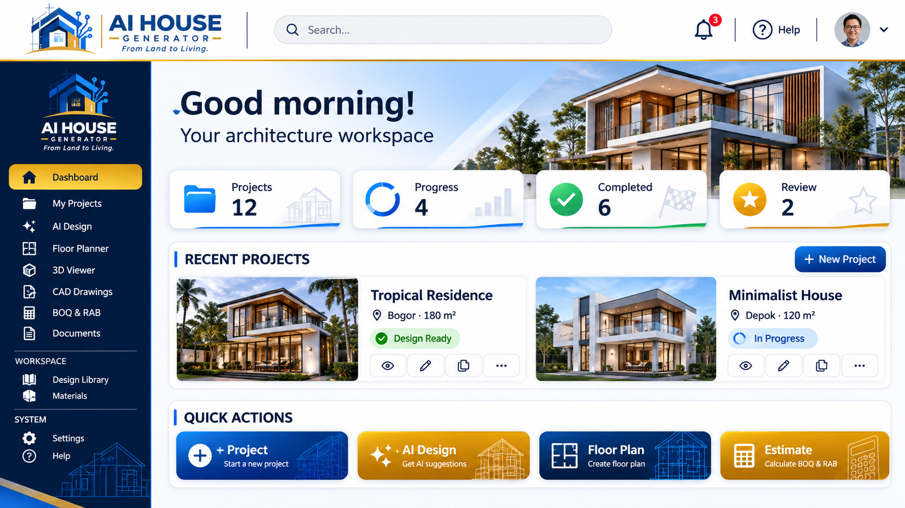
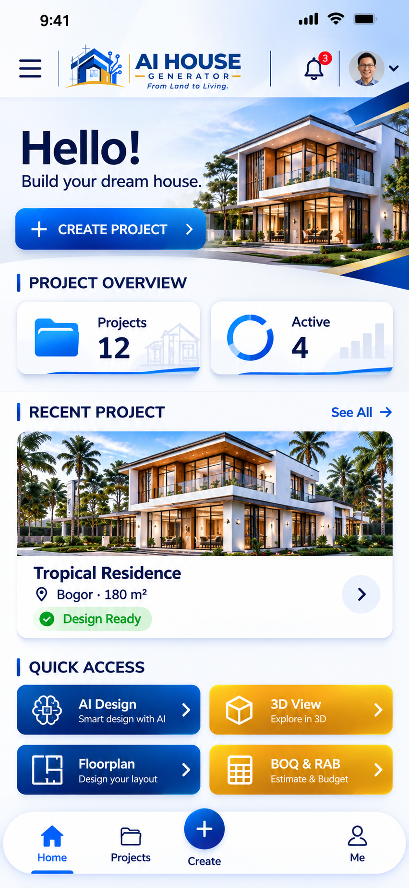
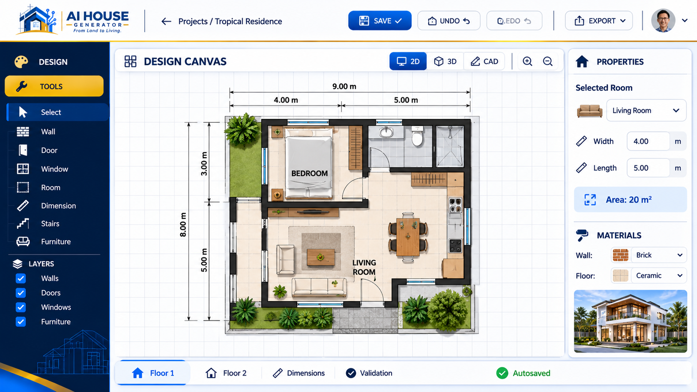

 <p align="center">
  
</p>

<h1 align="center">AI HOUSE GENERATOR</h1>

<p align="center">
  <strong>AI-Powered House Design & Project Management Platform</strong>
</p>

<p align="center">
  From Ideas to Intelligent Architectural Design
</p>

<p align="center">
  <a href="https://www.freecad.org/">
    
  </a>
</p>

<p align="center">
  <strong>Open-Source Parametric CAD Integration</strong>
</p>

<p align="center">
  <a href="https://github.com/sazwarriyadhs/aihouse">GitHub Repository</a>
  |
  <a href="https://www.freecad.org/">FreeCAD</a>
  |
  <a href="mailto:ptdigimediakomunika@gmail.com">Business Collaboration</a>
</p>

---

# AI House Generator

**AI House Generator (AHG)** is an AI-assisted house design and project management platform designed to connect intelligent architectural design workflows with professional CAD modeling tools and the building construction ecosystem.

AHG aims to provide an integrated environment for managing residential design projects, exploring architectural concepts, organizing design revisions, and developing structured house models through AI-assisted workflows.

The platform combines web and mobile applications, Go backend services, PostgreSQL data storage, Redis supporting services, AI service components, and a planned integration with **FreeCAD**, an open-source parametric 3D CAD platform.

Beyond software development, AI House Generator welcomes collaboration with startups, building-material manufacturers, distributors, contractors, architects, property developers, technology companies, and investors.

> **Project status — 23 November 2026:** The backend hardening baseline has been completed and locally verified. The API starts successfully, database migrations are verified, the API uses a restricted PostgreSQL runtime role, and the Go test and vet suites pass.

## Table of contents

- [Product vision](#product-vision)
- [Core capabilities](#core-capabilities)
- [Application preview](#application-preview)
- [FreeCAD integration](#freecad-integration)
- [Platform architecture](#platform-architecture)
- [Technology stack](#technology-stack)
- [Business collaboration](#business-collaboration--strategic-partnerships)
- [Repository structure](#repository-structure)
- [Backend requirements](#backend-requirements)
- [Configuration](#configuration)
- [Run the API locally](#run-the-api-locally)
- [API endpoints](#api-operational-endpoints)
- [Database security](#database-security-model)
- [Database migrations](#database-migrations)
- [Development checks](#development-checks)
- [Current backend verification](#current-backend-verification)
- [Development roadmap](#development-roadmap)
- [Engineering principles](#engineering-principles)
- [Project status](#project-status)
- [Contact](#contact)
- [License](#license)

---

# Product vision

AHG aims to bridge the gap between AI-generated architectural concepts, editable CAD models, and practical construction workflows.

The long-term vision is to create a connected platform where users can:

1. Describe house requirements using natural language.
2. Explore AI-assisted architectural concepts.
3. Develop and refine floor plans.
4. Convert structured design information into editable CAD models.
5. Visualize and review architectural designs.
6. Explore building materials and construction components.
7. Manage design revisions and project documentation.
8. Connect architectural designs with contractors and suppliers.
9. Continue design work using interoperable architectural tools.

AHG is intended to serve as the central project management, AI intelligence, and design orchestration platform, while specialized tools such as FreeCAD provide professional modeling capabilities.

## Our mission

To make residential design workflows more accessible, intelligent, collaborative, and connected to the real-world construction industry.

## Our direction

- AI-assisted architectural design.
- Parametric CAD and 3D modeling.
- Digital building-material ecosystems.
- Construction planning and project coordination.
- Open technology and interoperability.
- Collaboration across the architecture, engineering, and construction industries.

---

# Core capabilities

## 1. Project management

**Current foundation**

- Project API and persistent project data.
- Project-oriented organization of design records.
- PostgreSQL-backed storage.
- Project CRUD integration test coverage.

**Planned enhancements**

- Project overview and detail workspace.
- Project status and milestone tracking.
- Project requirements and metadata.
- Project search, filtering, and pagination.
- Project activity history and audit trail.
- Project documentation management.
- Project collaboration and access management.

## 2. House design management

**Current foundation**

- Design data structures.
- Design-version data structures.
- Persistent storage for design-related records.

**Planned enhancements**

- Multiple design concepts per project.
- Design comparison and revision history.
- Room and space organization.
- Floor-plan metadata and dimensions.
- Architectural annotations.
- Design approval and revision workflows.
- Reusable architectural components.
- Design specification management.

## 3. AI-assisted architectural design

AI-assisted design is a central part of the AHG product vision.

Potential capabilities include:

- Natural-language house requirements.
- AI-assisted architectural concept generation.
- Floor-plan and space-layout suggestions.
- Architectural style exploration.
- Design refinement based on user feedback.
- Context-aware design recommendations.
- AI-assisted architectural documentation.
- Structured design data generation for CAD workflows.
- Design optimization based on user-defined constraints.
- Intelligent design assistance throughout project development.

Specific AI model providers, generation pipelines, and supported output formats will be documented as their integrations are implemented and tested.

## 4. Architectural visualization

**Planned enhancements**

- 2D floor-plan visualization.
- 3D house visualization.
- Interior and exterior concept visualization.
- Material and color exploration.
- Lighting and environmental context.
- Design previews and presentation outputs.
- CAD model previews.
- Architectural rendering workflows.

## 5. Building materials and product ecosystem

AHG aims to explore connections between digital architectural design and the building-material supply chain.

**Potential capabilities**

- Building-material product catalogs.
- Material specifications and technical data.
- Material selection during design development.
- Product recommendations based on design requirements.
- Supplier and distributor information.
- Material quantity estimation.
- Cost estimation and comparison.
- Product availability and pricing integrations.
- Manufacturer product data integration.

These capabilities will be developed through appropriate industry partnerships and verified integrations.

## 6. Construction and contractor ecosystem

**Planned enhancements**

- Construction-oriented project documentation.
- Bill of quantities (BoQ) workflows.
- Material requirement planning.
- Contractor collaboration.
- Project execution tracking.
- Construction progress documentation.
- Cost estimation and budgeting.
- Design-to-construction information workflows.

Construction estimates and technical recommendations will require suitable engineering validation and clearly defined assumptions.

## 7. Mobile application

The repository includes a mobile application workspace under `apps/mobile`.

Potential capabilities include:

- Mobile project access.
- Design previews and review.
- Project progress monitoring.
- Design feedback and annotations.
- Notifications.
- Project documentation access.
- Mobile-friendly collaboration workflows.

## 8. Platform infrastructure

**Current foundation**

- Go HTTP API.
- PostgreSQL 17.
- Redis supporting service.
- Embedded SQL migration system.
- Separate migration and runtime database credentials.
- API health and readiness endpoints.
- Automated Go tests and static analysis.

---

# Application preview

AI House Generator provides a visual workspace for residential design projects, architectural planning, and mobile access.

The following screenshots showcase the current application interfaces.

## Web Dashboard

The AHG dashboard provides an overview of the platform and its project management workspace.

<p align="center">
  
</p>

## Mobile Application

AI House Generator also includes a mobile application workspace designed to extend project access and architectural workflows to mobile devices.

<p align="center">
  
</p>

## Floor Plan Editor

The Floor Plan Editor provides a dedicated workspace for architectural layout and house floor-plan design.

<p align="center">
  
</p>

*Screenshots represent the current application interfaces. Product capabilities and integrations are documented separately according to their implementation status.*

---

# FreeCAD integration

<p align="center">
  <a href="https://www.freecad.org/">
    
  </a>
</p>

<p align="center">
  <strong>FreeCAD — Open-Source Parametric 3D CAD</strong>
</p>

**[FreeCAD](https://www.freecad.org/)** is a key target for AHG's open-source CAD integration strategy.

FreeCAD is an open-source parametric 3D CAD application that can provide an editable modeling environment for architectural design workflows.

The intended integration is to make AHG capable of translating structured architectural requirements and AI-assisted design outputs into editable CAD models.

## Planned integration capabilities

- **Parametric house modeling:** Generate editable architectural objects from structured design parameters.
- **Floor-plan to 3D workflow:** Translate floor-plan information into three-dimensional building models.
- **Architectural components:** Work with walls, doors, windows, floors, roofs, stairs, and reusable building elements.
- **Python automation:** Investigate FreeCAD's Python API for automated model creation and modification.
- **Design revisions:** Connect CAD model revisions with AHG project and design-version management.
- **Model visualization:** Preview and inspect architectural models.
- **CAD interoperability:** Evaluate suitable import and export formats.
- **AI-to-CAD workflow:** Transform AI-assisted design outputs into structured, editable CAD geometry.

## Candidate integration technologies

| Technology | Intended purpose |
|---|---|
| FreeCAD | Parametric 3D CAD modeling |
| FreeCAD Python API | CAD automation and model generation |
| IFC | Building Information Modeling interoperability |
| STEP | 3D geometry exchange |
| DXF | 2D drawing exchange |
| STL | Mesh-based model export and visualization |

Format support will depend on the specific FreeCAD workbench, implementation, and compatibility testing.

**Integration status:** Planned — implementation and interoperability testing required.

Official website: https://www.freecad.org/

---

# Platform architecture

The intended high-level architecture separates project orchestration, AI intelligence, and CAD execution.

```text
                    AI HOUSE GENERATOR
                  CENTRAL DESIGN PLATFORM
                            |
          +-----------------+-----------------+
          |                 |                 |
       WEB APP          MOBILE APP        AI SERVICES
          |                 |                 |
          +-----------------+-----------------+
                            |
                       GO API LAYER
                            |
          +-----------------+-----------------+
          |                 |                 |
      PostgreSQL          Redis          Background Jobs
          |
    PROJECT / DESIGN /
    VERSION MANAGEMENT
                            |
                    CAD INTEGRATION LAYER
                            |
                         FreeCAD
                            |
                 PARAMETRIC 3D MODELS
                            |
              CAD / BIM INTEROPERABILITY
                            |
               ARCHITECTURAL WORKFLOWS
                            |
             MATERIALS / CONTRACTORS /
                CONSTRUCTION PARTNERS
```

This diagram represents the intended architecture, not a claim that every integration is currently operational.

## Architectural responsibilities

| Component | Responsibility |
|---|---|
| AHG Web | Main project and design workspace |
| AHG Mobile | Mobile access and design review |
| Go API | Application backend and business logic |
| PostgreSQL | Persistent project and design data |
| Redis | Supporting runtime services |
| AI Services | AI-assisted design processing |
| CAD Integration Layer | Communication between AHG and CAD tools |
| FreeCAD | Parametric CAD modeling and model generation |
| Material Integrations | Product catalogs and supplier data |
| Contractor Integrations | Construction-related workflows |

**Recommended integration approach:** Keep FreeCAD execution separate from the Go API. A dedicated CAD worker or integration service can communicate with FreeCAD through Python automation and process model-generation jobs asynchronously.

This keeps the API lightweight and allows CAD workloads to be managed independently.

---

# Technology stack

| Layer | Technology |
|---|---|
| Web application | `apps/web` |
| Mobile application | `apps/mobile` |
| Backend API | Go |
| Database | PostgreSQL 17 |
| Supporting runtime service | Redis |
| AI service workspace | `services/ai` |
| CAD integration target | FreeCAD |
| CAD automation target | FreeCAD Python API |
| BIM interoperability target | IFC |
| 3D exchange candidates | STEP, STL |
| 2D drawing exchange candidate | DXF |
| Database migrations | Embedded SQL / Go |
| Local infrastructure | Docker-compatible services |

---

# Business collaboration & strategic partnerships

<p align="center">
  <strong>LET'S BUILD THE FUTURE TOGETHER</strong>
</p>

AI House Generator is **open to collaboration with startups, established companies, technology providers, manufacturers, suppliers, contractors, architects, property developers, investors, and professionals** across the architecture, engineering, construction, and building-material industries.

We believe the future of residential design and construction will be driven by collaboration between AI technology, architectural expertise, digital engineering, innovative building materials, and construction professionals.

We welcome opportunities to build strategic partnerships, develop integrations, explore joint innovation, and create new business opportunities.

## Who we welcome

| Partner category | Potential collaboration |
|---|---|
| Startups & Technology Companies | AI integration, product innovation, software development, and technology partnerships |
| Building Material Manufacturers | Digital product catalogs, material specifications, product integration, and material recommendations |
| Building Material Distributors & Suppliers | Product availability, pricing integration, procurement workflows, and supplier networks |
| Construction Companies & Contractors | Construction planning, project estimation, material requirements, and project execution workflows |
| Architects & Architectural Studios | Architectural design workflows, CAD integration, design validation, and professional collaboration |
| Property Developers & Real Estate Companies | Residential concepts, housing development projects, and digital design solutions |
| Engineering & Consulting Firms | Structural, mechanical, electrical, and plumbing (MEP) collaboration |
| CAD, BIM & Software Providers | FreeCAD integration, BIM interoperability, 3D modeling, and digital engineering |
| Universities & Research Institutions | Applied AI research, architectural innovation, and collaborative development |
| Investors & Business Partners | Strategic investment, commercialization, market expansion, and joint ventures |

## Collaboration opportunities

### 1. Technology partnerships

- AI and machine learning integration.
- CAD and BIM interoperability.
- 3D modeling and visualization.
- Software and API integration.
- Cloud infrastructure and digital engineering.
- Open-source technology collaboration.

### 2. Building-material partnerships

We welcome building-material manufacturers, distributors, and suppliers interested in connecting their products and technical information with digital architectural workflows.

Potential cooperation includes:

- Digital product catalogs.
- Building-material specifications.
- Product dimensions and technical properties.
- Material recommendations.
- Material quantity estimation.
- Pricing and availability integration.
- Supplier and distributor networks.
- Product data and API integration.

### 3. Construction and contractor partnerships

We welcome construction companies and independent contractors interested in connecting digital house design with real-world construction activities.

Potential cooperation includes:

- Construction project planning.
- Material requirement estimation.
- Bill of quantities (BoQ) workflows.
- Construction cost estimation.
- Contractor service integration.
- Design-to-construction workflows.
- Project progress monitoring.
- Construction documentation.

### 4. Architectural and engineering partnerships

We welcome architects, architectural studios, engineers, and consultants who want to explore AI-assisted design and digital engineering workflows.

Potential cooperation includes:

- Architectural concept development.
- Floor-plan workflows.
- Parametric modeling.
- CAD/BIM integration.
- Structural and MEP coordination.
- Technical design review.
- Professional design validation.
- Research and development.

### 5. Product and platform integration

We are open to integrating third-party platforms, industry APIs, product catalogs, and complementary technologies.

Potential cooperation includes:

- Joint product development.
- API integration.
- White-label solutions.
- Technology licensing.
- Product distribution.
- Industry-specific solutions.
- Commercial integration.

### 6. Investment and strategic business development

We welcome discussions with investors, accelerators, venture builders, and strategic business partners interested in the AI, architecture, property technology, and construction technology sectors.

Potential cooperation includes:

- Strategic investment.
- Joint ventures.
- Commercial partnerships.
- Market expansion.
- Product commercialization.
- Business development.
- International collaboration.

## Collaboration models

We are open to different partnership models depending on each partner's objectives and capabilities.

1. Technology and integration partnerships.
2. Joint development and co-innovation.
3. Commercial and distribution partnerships.
4. Pilot projects and proof-of-concept initiatives.
5. Supplier and contractor ecosystem partnerships.
6. Research and institutional collaboration.
7. Licensing and white-label arrangements.
8. Strategic investment and joint ventures.

Each collaboration can be discussed individually to establish a mutually beneficial scope, responsibilities, commercial terms, intellectual property arrangements, and implementation roadmap.

## Local and international partnerships

AI House Generator welcomes collaboration opportunities from Indonesia and international markets.

We are particularly interested in connecting with companies and professionals working in:

- Artificial intelligence and software engineering.
- Architecture and digital design.
- Building materials and construction supplies.
- Construction and property development.
- CAD, BIM, and engineering software.
- Smart housing and sustainable construction.
- Digital transformation and industrial innovation.

**We are open to discussions with both early-stage startups and established enterprises.**

## Let's build the future together

Whether you are a startup developing innovative technology, a building-material manufacturer, a distributor, an architect, a contractor, a property developer, an engineering company, or an investor, we welcome the opportunity to explore how we can work together.

**AI House Generator is open to local and international partnerships.**

---

# Repository structure

```text
ai-house-generator/
├── apps/
│   ├── web/                     # Web application
│   └── mobile/                  # Mobile application
├── services/
│   ├── ai/                      # AI service workspace
│   └── api/
│       ├── cmd/
│       │   ├── server/          # HTTP API server
│       │   └── worker/          # Background worker entry point
│       ├── internal/
│       │   ├── database/        # Database configuration
│       │   ├── projects/        # Project API and data access
│       │   └── queue/           # Queue integration
│       └── migrations/          # Embedded SQL migrations
├── docs/
│   └── screenshots/
│       ├── dashboard.png
│       ├── mobile-ai-house.png
│       └── floor-plan-editor.png
├── backups/                     # Local backups; excluded from Git
├── README.md
└── .env.example
```

---

# Backend requirements

- Go toolchain compatible with `services/api/go.mod`.
- PostgreSQL 17.
- Redis.
- Node.js and the package manager required by the web application.
- Flutter SDK for mobile development.
- Docker Desktop recommended for local infrastructure on Windows.

FreeCAD will be required when developing or testing the CAD integration layer.

## Verified local development endpoints

| Service | Local endpoint |
|---|---|
| PostgreSQL | `127.0.0.1:55432` |
| Redis | `127.0.0.1:56379` |
| API | `127.0.0.1:8097` |

These are local development endpoints, not production service addresses.

---

# Configuration

Create or update the root `.env` file using `.env.example` as the template.

Never commit `.env`, passwords, tokens, database dumps, or other secrets.

## Database configuration

| Environment variable | Purpose |
|---|---|
| `POSTGRES_HOST` | PostgreSQL host |
| `POSTGRES_PORT` | PostgreSQL port |
| `POSTGRES_DB` | Application database |
| `POSTGRES_MIGRATOR_USER` | Migration login |
| `POSTGRES_MIGRATOR_PASSWORD` | Migration password |
| `POSTGRES_RUNTIME_USER` | Restricted API runtime login |
| `POSTGRES_RUNTIME_PASSWORD` | Runtime password |
| `REDIS_PORT` | Redis port |
| `PORT` | HTTP API port; default `8097` |

Use strong, unique passwords in local and deployed environments.

Never expose `.env` contents in issues, chat messages, logs, or source control.

---

# Run the API locally

From the repository root in PowerShell:

```powershell
Push-Location .\services\api
go run ./cmd/server
```

The API listens on:

```text
http://127.0.0.1:8097
```

Start PostgreSQL and Redis before starting the API.

The server:

1. Loads the migration database configuration.
2. Connects using the migration account.
3. Applies pending embedded SQL migrations.
4. Closes the migration connection pool.
5. Loads the restricted runtime database configuration.
6. Starts the API using the runtime account.

---

# API operational endpoints

| Method | Endpoint | Purpose |
|---|---|---|
| `GET` | `/healthz` | Basic API health |
| `GET` | `/api/v1/health` | API health route |
| `GET` | `/api/v1/ready` | Database and Redis readiness |
| `GET` | `/api/v1/projects` | Project collection |
| `GET` | `/api/v1/projects/` | Project resource route |

Project routes support the operations implemented in the current API. Consult the source code and tests for exact request and response schemas.

## Operational checks

```powershell
Invoke-RestMethod http://127.0.0.1:8097/healthz
Invoke-RestMethod http://127.0.0.1:8097/api/v1/ready
```

A successful readiness response reports PostgreSQL and Redis as connected.

---

# Database security model

The local PostgreSQL setup separates administrative access, object ownership, migrations, and application runtime.

| Role | Responsibility |
|---|---|
| `ahg_app` | Administrative/bootstrap access; not for API runtime |
| `ahg_owner` | `NOLOGIN` owner of application schemas and objects |
| `ahg_migrator` | Migration login; assumes `ahg_owner` |
| `ahg_runtime` | Restricted API runtime login |

The runtime role:

- Is not a PostgreSQL superuser.
- Does not own application objects.
- Has the required access to the `core` schema.
- Has CRUD privileges on application tables.
- Does not have `TRUNCATE` permission.
- Does not have access to the internal `app` migration schema.

Do not use the administrative/bootstrap account as the API runtime account.

---

# Database migrations

SQL migrations are embedded into the API using Go's `embed` package.

The migration runner:

- Applies migrations in sorted order.
- Uses a PostgreSQL advisory lock.
- Records applied migrations in `app.schema_migrations`.
- Stores SHA-256 checksums.
- Rejects modifications to previously applied migrations.
- Runs each migration transactionally.

Initial migration:

```text
services/api/migrations/0001_initial_core.sql
```

It establishes the `core` schema and the initial project, design, and design-version data structures.

---

# Development checks

Run from `services/api`:

```powershell
go test ./...
go vet ./...
```

Both commands passed during backend hardening verification on 23 November 2026. The project CRUD integration test also passed against the dedicated test database.

---

# Current backend verification

The following checks were completed during the local hardening session:

- PostgreSQL ownership assigned to non-login `ahg_owner`.
- Separate migration and runtime credentials configured.
- Migration runner verified against the test database.
- Migration checksum verified against the main database.
- Project CRUD integration test passed.
- `go test ./...` passed.
- `go vet ./...` passed.
- `/healthz` returned `status: ok`.
- `/api/v1/ready` reported PostgreSQL and Redis as connected.
- PostgreSQL activity confirmed that API connections use `ahg_runtime`.

These results describe the local development environment at the time of verification. They are not claims of production deployment or production certification.

---

# Development roadmap

| Phase | Focus | Status |
|---|---|---|
| Phase 1 | Backend and database security hardening | Completed |
| Phase 2 | Project detail and data integrity | Next |
| Phase 3 | Design management and revision workflows | Planned |
| Phase 4 | AI-assisted design service integration | Planned |
| Phase 5 | FreeCAD integration and CAD automation | Planned |
| Phase 6 | 2D/3D visualization and CAD interoperability | Planned |
| Phase 7 | Building materials and supplier ecosystem | Planned |
| Phase 8 | Contractor and construction workflows | Planned |
| Phase 9 | Collaboration and project workspace enhancements | Planned |
| Phase 10 | Deployment, observability, and production readiness | Planned |

## Phase 2 — Project detail and data integrity

1. Project → Design → Design Version relationship validation.
2. Foreign-key and data consistency checks.
3. Transaction boundaries and CRUD error handling.
4. Pagination, filtering, and API edge cases.
5. Automated negative-path and boundary-condition tests.

## Future AI development

- AI-assisted architectural concept exploration.
- Natural-language design requirements.
- Floor-plan generation workflows.
- Structured design parameter extraction.
- AI-assisted architectural documentation.
- Design refinement and recommendations.

## Future FreeCAD integration milestones

1. Evaluate FreeCAD installation and Python automation requirements.
2. Define the AHG-to-FreeCAD integration contract.
3. Design a structured architectural model representation.
4. Map architectural elements to parametric CAD objects.
5. Generate and validate an initial house model.
6. Connect CAD files and model revisions to AHG projects.
7. Evaluate IFC, STEP, DXF, STL, and other interoperability workflows.
8. Add automated CAD generation and validation tests.

## Future business ecosystem milestones

1. Identify potential building-material manufacturer and distributor partners.
2. Define a standard product catalog and material specification structure.
3. Explore material pricing and availability integration.
4. Develop contractor and construction collaboration workflows.
5. Explore architectural and engineering service partnerships.
6. Establish pilot collaborations and joint product initiatives.

---

# Engineering principles

- Preserve existing dashboard and workspace UI unless a UI change is explicitly requested.
- Keep backend hardening and visual development separate.
- Make incremental, testable changes.
- Back up databases before schema or role modifications.
- Keep secrets and local artifacts out of source control.
- Validate data integrity before important migrations.
- Distinguish implemented functionality from planned product capabilities.
- Prefer open standards and interoperable design formats where practical.
- Keep CAD execution independent from the main API service.
- Build partnerships around mutual value, clear responsibilities, and sustainable collaboration.

---

# Project status

AI House Generator is under active development.

Its verified backend foundation provides a starting point for expanding project management, design workflows, AI-assisted architectural capabilities, open-source CAD integration, and collaboration with the construction and building-material industries.

**The long-term goal is to connect AI-assisted architectural design with editable parametric CAD models and real-world construction ecosystems through one integrated project workflow.**

---

# Contact & Business Inquiries

<p align="center">
  
</p>

<p align="center">
  <strong>AI HOUSE GENERATOR</strong>
</p>

Developed by **PT DIGI MEDIA KOMUNIKA**

For:

- Business collaboration.
- Technology partnerships.
- Building-material manufacturer and supplier partnerships.
- Contractor and construction partnerships.
- Architectural and engineering collaborations.
- CAD and BIM integration.
- Joint product development.
- Strategic investment and business development.

**Business Email:** [ptdigimediakomunika@gmail.com](mailto:ptdigimediakomunika@gmail.com)

**GitHub Repository:** [github.com/sazwarriyadhs/aihouse](https://github.com/sazwarriyadhs/aihouse)

**FreeCAD:** [www.freecad.org](https://www.freecad.org/)

**We welcome local and international collaboration opportunities.**

*Let's turn ideas into intelligent designs and build better homes together.*

---

# License

No open-source license has been specified yet. All rights are reserved unless and until a license is added to this repository.
