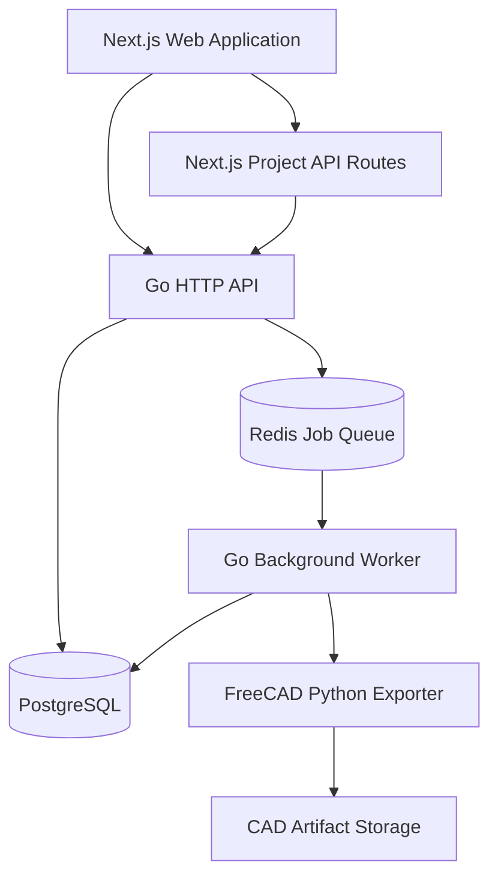

# AI House Generator

<p align="center">
  
</p>

<p align="center">
  <strong>AI-assisted residential design and project workflows with an open-source CAD export pipeline.</strong>
</p>

AI House Generator (AHG) is a development-stage platform for managing house-design projects, editing structured floor plans, and generating CAD deliverables from versioned design data. The project is being developed by **PT DIGI MEDIA KOMUNIKA**.

The current implementation combines a Next.js web application, a Go API, PostgreSQL, Redis-backed background jobs, and FreeCAD Python automation.

> **Project status:** Active development. Project management, floor-plan data workflows, and the initial asynchronous CAD export pipeline are implemented in the `feature/cad-export-pipeline` branch. AI-assisted generation, complete architectural documentation, advanced visualization, and production deployment remain future work unless explicitly described as implemented below.

---

## What is implemented

### Project and design workflow

- Web application workspace for browsing and working with house-design projects.
- Project detail and edit routes.
- Floor-plan editor workflow and project-scoped floor-plan API routes.
- Structured floor-plan data for rooms, walls, doors, and windows.
- Validation of floor-plan identifiers, dimensions, references, and site-boundary constraints.
- Immutable design-version creation when floor-plan data is saved.

### Asynchronous CAD export

- Dedicated Go worker entry point consuming background jobs.
- CAD export job type: `cad.export`.
- Export requests identify the project, design, immutable design version, and target (`2d`, `3d`, or `both`).
- FreeCAD automation through the embedded Python exporter.
- Artifact metadata persisted in PostgreSQL, including storage key, SHA-256 checksum, file size, project/design/version references, and export dimension/format.
- Export execution is separated from the HTTP API process.

**Current generated deliverables**

| Export target | File formats | Status |
|---|---|---|
| 2D | DXF, FCStd | Implemented |
| 3D | FCStd, STEP | Implemented |
| 3D | STL | Not currently generated by the exporter |

The migration schema recognizes STL as an allowed artifact format, but that does **not** mean STL generation is implemented. IFC/BIM export is also not currently implemented.

### Backend foundation

- Go API and worker services.
- PostgreSQL-backed project, design, design-version, and CAD-artifact data.
- Embedded SQL migrations.
- Separate PostgreSQL migration and runtime credentials.
- Redis integration for background job processing.
- CAD artifact integrity metadata using SHA-256.

---

## Architecture



The API handles application requests and data persistence. CAD generation runs asynchronously in the worker so that model generation does not need to run inside an HTTP request.

### Technology stack

| Layer | Technology |
|---|---|
| Web application | Next.js, React, TypeScript |
| Package management | pnpm workspaces |
| Backend API | Go |
| Background processing | Go worker, Redis |
| Database | PostgreSQL |
| CAD automation | FreeCAD Python API |
| 2D CAD output | DXF |
| 3D exchange output | FCStd, STEP |
| Mobile workspace | Flutter project scaffold |

---

## Repository layout

```text
ai-house-generator/
├── apps/
│   ├── web/                         # Next.js web application
│   └── mobile/                      # Flutter mobile application
├── services/
│   ├── api/
│   │   ├── cmd/
│   │   │   ├── server/              # HTTP API entry point
│   │   │   └── worker/              # Background worker entry point
│   │   ├── internal/
│   │   │   ├── cad/                 # CAD executor, repository, exporter
│   │   │   ├── database/            # PostgreSQL configuration
│   │   │   ├── projects/            # Project and floor-plan workflows
│   │   │   ├── queue/               # Redis queue integration
│   │   │   └── worker/              # Job processing
│   │   └── migrations/              # Embedded SQL migrations
│   └── ai/                          # AI service workspace
├── docs/                            # Project documentation
├── add_azwar_roof.FCMacro           # Standalone FreeCAD macro
├── add_azwar_stairs_balcony.FCMacro # Standalone FreeCAD macro
├── README.md
└── .env.example
```

The standalone FreeCAD macros are separate from the worker's embedded exporter. Their presence in the repository should not be interpreted as proof that roof, stair, or balcony generation is part of the current automated export pipeline.

---

## Requirements

| Dependency | Requirement |
|---|---|
| Node.js | `>=22.13.0` |
| pnpm | `12.22.0` (declared package manager) |
| Go | `1.25.0` (module version) |
| PostgreSQL | 17 |
| Redis | Required for background job processing |
| FreeCAD | Required for CAD export execution |
| Flutter SDK | Required only for mobile development |

Docker Desktop or another Docker-compatible runtime is recommended for local PostgreSQL and Redis services.

---

## Local development

The commands below assume Windows PowerShell and a local development environment. Start PostgreSQL and Redis before starting the API and worker.

### 1. Configure environment

Create a root `.env` file based on `.env.example`.

At minimum, configure the PostgreSQL bootstrap, migrator, and runtime credentials. Review the CAD settings as well:

| Variable | Purpose |
|---|---|
| `POSTGRES_DB` | Application database name |
| `POSTGRES_HOST` / `POSTGRES_PORT` | PostgreSQL connection |
| `POSTGRES_USER` / `POSTGRES_PASSWORD` | Bootstrap account for database initialization |
| `POSTGRES_MIGRATOR_USER` / `POSTGRES_MIGRATOR_PASSWORD` | Migration account |
| `POSTGRES_RUNTIME_USER` / `POSTGRES_RUNTIME_PASSWORD` | Restricted application/worker account |
| `CAD_STORAGE_ROOT` | CAD artifact storage directory |
| `FREECAD_PYTHON` | Path to the Python executable that can import FreeCAD modules |

The example FreeCAD path in `.env.example` is Windows-specific. Set it to the actual FreeCAD Python executable on your machine.

Never commit real credentials, tokens, private keys, database dumps, or local environment files.

### 2. Install JavaScript dependencies

From the repository root:

```powershell
pnpm install
```

### 3. Run the web application

From the repository root:

```powershell
pnpm --filter ./apps/web dev
```

Use the local URL printed by Next.js in the terminal.

### 4. Run the Go API

From the repository root:

```powershell
Push-Location .\services\api
go run ./cmd/server
```

The API's default local base URL in the web route configuration is:

```text
http://127.0.0.1:8097
```

If your API uses another address, configure the web application's `API_BASE_URL` accordingly.

### 5. Run the background worker

In a separate PowerShell terminal:

```powershell
Push-Location .\services\api
go run ./cmd/worker
```

The worker requires reachable PostgreSQL and Redis services and a working FreeCAD Python executable for CAD export jobs.

---

## Project and floor-plan API

The web application includes project-scoped API routes that forward requests to the Go API.

| Method | Web route | Purpose |
|---|---|---|
| `PUT` | `/api/projects/:id` | Update project |
| `GET` | `/api/projects/:id/floor-plans` | Read current floor-plan data |
| `PUT` | `/api/projects/:id/floor-plans` | Validate and save floor-plan data as a new design version |

The corresponding backend API routes are under `/api/v1/projects`. Consult the Go handlers and tests for the complete request/response contract.

Floor-plan data currently represents rooms, walls, doors, and windows using metric dimensions. The API validates element identifiers, geometry values, wall/opening references, and relevant land-boundary constraints before saving a new design version.

---

## CAD export workflow

1. A CAD export job is submitted with project, design, version, and target identifiers.
2. The worker receives the `cad.export` job from the Redis-backed queue.
3. The executor validates the request and loads the selected design version.
4. The embedded FreeCAD Python exporter builds the requested 2D and/or 3D document.
5. Generated files are checked for existence and non-zero size, then hashed.
6. Artifact metadata is stored in PostgreSQL and the files are retained in the configured CAD storage directory.

### Export targets

| Target | Expected artifacts |
|---|---|
| `2d` | DXF and FCStd |
| `3d` | FCStd and STEP |
| `both` | Both 2D and 3D artifact sets |

Artifact records include the job, project, design, and immutable version identifiers. The database enforces consistency between the referenced project/design/version chain and records the SHA-256 checksum and file size.

**Current scope and limitations**

- The 2D exporter creates room boundary geometry and wall centerlines.
- The current 3D exporter creates a building slab and wall solids, including supported door/window opening cuts.
- The automated exporter does not yet generate a complete construction-ready architectural model.
- Roof, stair, balcony, railing, MEP, structural engineering, and detailed material assemblies are not part of the current worker export contract.
- STEP output is an exchange deliverable; it is not an IFC/BIM model.
- Generated geometry must be reviewed in CAD software and by qualified architecture/engineering professionals before any construction use.

---

## Database migrations and security

SQL migrations are embedded in the Go API and are applied by the migration runner.

The database setup separates bootstrap, migration, object ownership, and runtime responsibilities. The API and worker should use the restricted runtime credentials, not the bootstrap or database-owner account.

The CAD artifact migration adds:

- Project/design and design/version consistency constraints.
- Supported dimension and format checks.
- Unique storage keys.
- SHA-256 checksum and positive file-size constraints.
- Unique output records per job, dimension, and format.

Back up important databases before applying schema changes. Do not edit migrations that have already been applied; create a new migration instead.

---

## Development checks

Run Go tests from `services/api`:

```powershell
go test ./... -count=1
```

Run frontend checks from the repository root:

```powershell
pnpm lint
pnpm build
```

### Latest local verification recorded

On 25 November 2026, the development session reported:

- `go test ./... -count=1` — passed.
- `pnpm lint` — passed.
- `pnpm build` — passed.

These are local development results for the recorded source state. They are not a statement that a production deployment, external CAD interoperability certification, or construction-code validation has been completed.

---

## Roadmap

| Area | Current status |
|---|---|
| Project workspace and project editing | Implemented foundation |
| Structured floor-plan read/write workflow | Implemented foundation |
| Immutable design-version persistence | Implemented |
| Redis-backed worker and CAD export executor | Implemented foundation |
| 2D DXF / FCStd export | Implemented |
| 3D FCStd / STEP export | Implemented foundation |
| Full architectural model generation | In progress / future expansion |
| Roof, stairs, balcony and detailed building components in automated exporter | Planned |
| AI-assisted brief interpretation and floor-plan generation | Planned |
| Interactive 2D/3D model visualization | Planned / expanding |
| IFC/BIM interoperability | Planned |
| BOQ, RAB and material estimation | Planned |
| Supplier, contractor and construction ecosystem integrations | Planned |
| Production deployment, monitoring and operational hardening | Planned |

Roadmap items may change as implementation and validation progress.

---

## Engineering principles

- Keep project data and design versions traceable.
- Treat saved design versions as immutable inputs to export jobs.
- Keep CAD generation outside the HTTP request lifecycle.
- Validate input geometry and artifact metadata.
- Preserve existing work and use incremental, testable changes.
- Keep credentials and local build artifacts out of source control.
- Clearly distinguish implemented capabilities from planned features.
- Treat generated designs as concept and engineering-support artifacts, not substitutes for professional review, permits, or regulatory approval.

---

## Business collaboration

AI House Generator is open to discussions with:

- Architects, architectural studios, and engineering consultants.
- CAD/BIM and software technology providers.
- Building-material manufacturers, distributors, and suppliers.
- Construction companies, contractors, and property developers.
- Universities, research institutions, and innovation programs.
- Investors and strategic business partners.

Potential collaboration areas include technology integration, joint development, digital product catalogs, material data, construction workflows, research, pilot projects, and commercialization.

**Developed by PT DIGI MEDIA KOMUNIKA**

- Business email: [ptdigimediakomunika@gmail.com](mailto:ptdigimediakomunika@gmail.com)
- Repository: [github.com/sazwarriyadhs/aihouse](https://github.com/sazwarriyadhs/aihouse)
- FreeCAD: [freecad.org](https://www.freecad.org/)

---

## License

No open-source license has been specified in this repository yet. Unless and until a license is added, all rights are reserved. Do not assume that the source code is available for unrestricted reuse.
